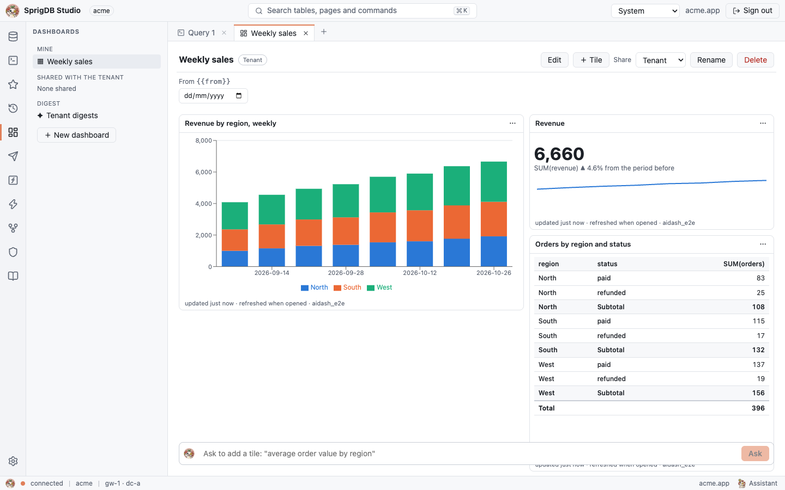
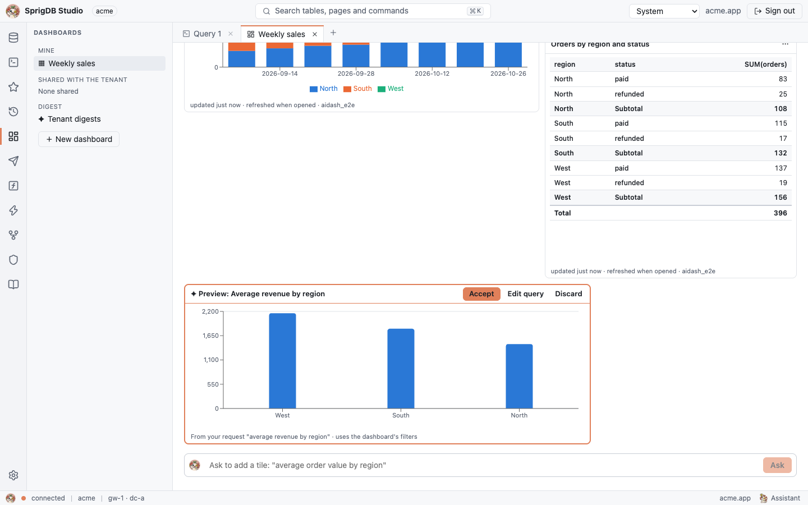

# Dashboards

A dashboard is a page of charts in [Studio](studio.md). Each chart is a **tile**: one read-only `SELECT`, a chart built from its result, a refresh interval and a place on a 12-column grid. You build charts the way you would in Tableau, by putting fields on shelves, or let the [data assistant](assistants.md) propose one.

Dashboards are kept in your tenant's catalog, so they follow you to any browser. A dashboard is yours alone until you share it with the whole tenant.



## Who sees and changes what

| | Owner | Tenant administrator (`SPRIG_TENANT_ADMIN`) | Any other user of the tenant |
|---|---|---|---|
| A dashboard shared only with its owner ("Only me") | sees, edits, deletes | doesn't see it | doesn't see it |
| A dashboard shared with the tenant | sees, edits, deletes, unshares | sees, edits, deletes | sees, runs its tiles |
| Sharing and unsharing | yes | no | no |

- **Every tile runs as the person looking at it.** A tile's query runs with the viewer's own grants and row-level security, never the owner's. Two people looking at the same shared dashboard can see different numbers, and someone without `SELECT` on a tile's tables gets that tile's access-denied error instead of a chart.
- A dashboard someone can't see answers as if it didn't exist (39792).
- Changing a dashboard someone else owns, without the right, fails with 1227.

## Making a dashboard

In Studio, choose **Dashboards** in the activity bar. The side panel lists:

- **Mine**: your own dashboards;
- **Shared with the tenant**: the tenant's shared dashboards, with their owners;
- **Digest** (tenant administrators): the tenant's [digests](assistants.md#digests).

**＋ New dashboard** makes an empty one. Its header has the name, a badge (**Only me** or **Tenant**), **Edit**, **＋ Tile**, **Share** (owners only), **Rename** and **Delete**.

### Adding a tile from a query

Under any SQL result in a query tab, **▦ Add to dashboard** asks for a dashboard (or a new one) and a title, then saves the statement as a tile. Its first chart is the one Show Me suggests for the result's columns (see [Show Me](#show-me)). **Add and edit chart** goes on to the chart editor.

A tile's query must be one read: `SELECT`, `VALUES`, `TABLE` or a set operation of them, without `INTO` or a locking clause. A trailing `;` is dropped.

### Adding a tile with the assistant

At the bottom of a dashboard you can edit, the ask bar takes a request such as "average order value by region". The data assistant answers with a tile proposal; Studio runs its query as you and shows it as a **Preview** tile with three buttons:

- **Accept** adds it to this dashboard.
- **Edit query** opens it in the chart editor, unsaved.
- **Discard** turns it down.



The ask bar needs the data assistant on for the tenant (`ai.enabled`) and a model for it (`ai.model.data`); see [AI assistants](assistants.md). Accepting is the same call as accepting the proposal anywhere else: `POST /v1/ai/proposals/{id}:accept`, with the dashboard you chose.

## The chart editor

**＋ Tile**, **Edit query and chart** in a tile's menu, or **Add and edit chart** opens the editor:


- **On the left**, the database, the query and **Run**. Running it lists the result's fields: **dimensions** (text, ids and flags), dates, and **measures** (numbers). Drag a field onto a shelf, or use the **＋** menu beside it.
- **Columns** and **Rows** are the axes. A measure on Rows draws vertical bars; on Columns, horizontal ones. A dimension on the same shelf as another becomes a series.
- **Filters** keeps only rows whose field holds one of the values you list.
- **The Marks card** has the mark (bar, line, and the rest below) and the shelves **Colour** (a series per value, or a colour scale for a measure), **Size** (a scatter's bubble size, a Gantt bar's length in days), **Label** (values on the marks), **Detail** (more grouping without colour) and **Tooltip**. Then **Stack** (none, stacked or 100%), **Sort** (by a field, up or down), **Top** (keep the first N categories) and **Facet** (small multiples: one small chart per value, up to 12).
- **A measure's pill** chooses its aggregation: `SUM`, `AVG`, `COUNT`, `CNTD` (count distinct), `MIN`, `MAX`, `MEDIAN` or `NONE` (each row on its own). On Rows, with two or more measures, **⇤** puts one on the right-hand axis as a line: a combo chart.
- **A date's pill** chooses its part: `YEAR`, `QUARTER`, `MONTH`, `WEEK` (weeks start on Monday), `DAY`, `HOUR` or `EXACT`. Dates are read as UTC.
- **Refresh** runs the tile again by itself every minute, 5 minutes, 15 minutes or hour; by default it runs when the dashboard opens and when you ask.

**Save tile** checks the tile as the gateway will, and keeps it. The chart is drawn in your browser from the query's rows, so a query that already groups (`GROUP BY`) keeps tiles fast. A tile holds at most `studio.max_result_rows` rows, and runs for at most `studio.statement_timeout_ms`.

### Show Me

Show Me lights up the chart types that fit the fields on the shelves and greys out the rest, with a note on why. It follows Tableau's rules of thumb, and the assistant's tiles are checked against the same rules:

| On the shelves | Show Me suggests |
|---|---|
| A latitude and a longitude field | a point map |
| A country field and one measure | a filled map |
| One measure and nothing else | a KPI |
| Two or more measures, no dimension | a scatter plot |
| A date and one or more measures | a line |
| Two dimensions and a measure | a heatmap |
| A dimension and a measure | a bar chart |
| Nothing that fits a chart | a text table |

A chart type that doesn't fit its shelves can't be saved; the editor says which ones do. Clicking a type in the gallery moves your fields to suit it (for example, a horizontal bar puts the measure on Columns) and never removes one.

### Chart types

| Type | Built from |
|---|---|
| Bar: vertical, horizontal, side by side, stacked, 100% stacked | a dimension and one or more measures; a second dimension or Colour makes the series |
| Line and area, stacked or not | a dimension (usually a date) and measures |
| Combo, two axes | bars and a line, the line's measure on the right-hand axis |
| Scatter and bubble | two measures, a third on Size for bubbles |
| Pie and donut | a dimension on Colour and one measure; slices past the eighth fold into "Other" |
| Waterfall | a dimension and a measure: each step from the running total, then the total |
| Histogram | one measure, binned (5 to 30 bins) |
| Box plot | one measure's row values (`NONE`), per value of a dimension |
| Heatmap and highlight table | two dimensions and a measure, in a single-hue colour scale; the highlight table shows the numbers |
| Treemap | one or two dimensions (nested) and a measure |
| Funnel | a dimension and a measure, largest first |
| Radar | a dimension for the spokes and measures |
| Sankey | two dimensions (from and to) and a measure |
| KPI | one measure; with a date, the latest period, the change from the one before, and a sparkline |
| Gauge | one measure, against a second as the target (or a round maximum) |
| Bullet | a measure and a target measure, per value of a dimension |
| Gantt | a task, a start date, and an end date or a duration in days on Size |
| Text table and pivot table | any fields; the pivot puts Rows' dimensions down the side and Columns' across, with subtotals for each value of the first row dimension and a grand total (see below) |
| Point map | a latitude and a longitude field, sized by Size and coloured by Colour (see below) |
| Filled map | a country field and one measure: each country coloured by the measure (see below) |

Any of these can be split into small multiples with **Facet**. Colours come from one colour-blind-safe palette, chosen separately for light and dark themes; a series keeps its colour by its first appearance.

**Pivot subtotals and totals** are worked out from the rows of their group, never by adding up the numbers shown. A subtotal of `AVG(price)` is the average over every row of that group, so a group with many rows counts for more than a group with few; a subtotal of `MIN`, `MAX`, `MEDIAN` or `CNTD` is that group's minimum, maximum, median or distinct count. For `SUM` and `COUNT` the two are the same. The same holds for each column group and for the grand total.

### Maps

A **point map** (`map-point`) draws one point per place:

- **Where.** A field named `lat` or `latitude` and one named `lon`, `lng`, `long` or `longitude`, on any shelf. Case doesn't matter. Locations are never summed: Studio treats these fields as dimensions, and rows at the same place make one point, with their measures aggregated.
- **Size** sizes the points by area. **Colour** colours them: a dimension gives each value a colour from the chart palette, with a legend; a measure gives a single-hue scale. Hovering over a point shows its fields. Rows without a valid latitude and longitude are left out, and the map says how many. A map draws at most 5,000 places.
- **Base map.** Without `studio.map_tile_url` (the default), the points are drawn on a plain background with lines every 30 degrees, and Studio fetches nothing from outside the gateway. To draw a base map, set `studio.map_tile_url` to an XYZ raster tile template from a tile server you're allowed to use, such as `https://tiles.example.com/{z}/{x}/{y}.png`. Studio adds that server to its Content-Security-Policy and shows its host as the map's attribution. In a dark theme the tiles are dimmed.
- **Browsers.** Maps need WebGL. MapLibre loads only when a dashboard first shows a map.

A **filled map** (`map-filled`) colours each country by a measure:

- **Which countries.** A field named `country`, `country_code`, `country_name`, `country_iso`, `iso2` or `iso3`, on any shelf; case doesn't matter. Its values may be country names (`Germany`, `United States`, `Côte d'Ivoire`) or ISO 3166-1 codes: alpha-2 (`DE`), alpha-3 (`DEU`) or numeric (`276`). Names are compared without case, accents or punctuation (`Saint` and `St.` are the same), and common other names are known too, such as `USA`, `UK`, `Russian Federation`, `Viet Nam`, `Hong Kong SAR China` and `Cape Verde`. Small countries, islands and city states have their own shape, such as Singapore, Hong Kong (`HK`, `HKG`, `344`), Macao, Malta, Bahrain, Mauritius and the Maldives. For a column with another name, use an alias: `SELECT nation AS country, ...`.
- **The measure** is the one on Colour, or else the one on Columns or Rows. Each country's rows are aggregated with the measure's own aggregation, after matching, so `US` and `United States` count as one country. Tooltip measures are aggregated the same way and shown on hover.
- **Colours.** Up to six steps of one hue, by quantiles: each step holds about the same number of countries, so one very large value doesn't leave every other country in the lightest step. Countries with the same value are always in the same step. With six or fewer different values, each value is a step of its own, and a single value is one colour. The legend shows each step's range, in the tile's number format, and hovering over a step says how many countries it holds; countries without data are grey. The scale is chosen separately for light and dark themes.
- **Rows that match no country** are left out, and the map says how many, with a few of their values. That includes empty values, places that aren't countries, and territories without a shape of their own (such as Gibraltar, Tokelau or Christmas Island). A few shapes have no ISO code and are always grey: Northern Cyprus, Somaliland, the Siachen Glacier, and Christmas Island with the Cocos Islands (one shape). Ashmore and Cartier Islands take Australia's colour.
- **Shapes.** The country outlines are Natural Earth's 1:50 million countries (241 shapes), bundled with Studio: they load from the gateway (about 200 KB compressed), only when a dashboard first shows a filled map, and nothing is fetched from anywhere else. Antarctica is drawn only when it has data. States and provinces aren't drawn.

For example, sales recorded with both codes and names:

```sql test
CREATE TABLE sales (id INT PRIMARY KEY, country VARCHAR(40), revenue DECIMAL(10,2));
INSERT INTO sales VALUES
  (1, 'DE', 120.00), (2, 'Germany', 80.00), (3, 'USA', 300.00),
  (4, 'United States', 50.00), (5, 'IN', 75.50), (6, 'Atlantis', 9.99),
  (7, 'SG', 42.00);
SELECT country, SUM(revenue) AS revenue FROM sales GROUP BY country ORDER BY country;
```

```text output
country	revenue
Atlantis	9.99
DE	120.00
Germany	80.00
IN	75.50
SG	42.00
United States	50.00
USA	300.00
```

With `country` on Columns and `revenue` on Rows, the tile colours Germany 200 (`DE` and `Germany`), the United States 350, India 75.5 and Singapore 42, and says that one row (`Atlantis`) matched no country. The four countries have four different values, so the legend has four steps, one per value: 42, 75.5, 200 and 350.

Show Me suggests a point map when a latitude and a longitude are on the shelves, and a filled map for a country field and one measure. Other place names, such as `city` or `state`, make neither: Show Me goes on to its next rule. The assistant's tiles follow the same rules.

## Using a dashboard

- **Tile menu (⋯)**: **Edit query and chart**, **Change chart** (the editor, at Show Me), **Duplicate**, **Open in a query tab**, **Run again** and **Remove**. People who can't edit the dashboard see only **Open in a query tab** and **Run again**.
- **Each tile's footer** says when it last ran, how often it runs again and its database.
- **Edit mode** (**Edit**, then **Done editing**) shows the grid. Drag a tile by its **⠿** handle to move it, or by its bottom-right corner to resize it. With the handle focused, the arrow keys move a tile one cell and `Shift` with the arrow keys resizes it. Tiles a moved tile lands on move down out of its way. **✕** removes a tile.

### Filters

A dashboard can have up to 20 filters: named values its tiles' queries use as `{{name}}`. For example, with a date filter named `from`:

```sql
SELECT DATE(created_at) AS day, SUM(total) AS revenue
FROM orders
WHERE created_at >= {{from}}
GROUP BY day
```

- A filter is `text`, `number`, `date` (`YYYY-MM-DD`, or with a time `HH:MM[:SS[.ffffff]]`) or `list` (for `IN {{name}}`).
- Write `{{name}}` bare, never inside quotes: SprigDB puts the value in as a quoted literal of the filter's kind (quotes and backslashes doubled), so a value can never be read as SQL. A number must be a number, a date a date. An empty value is `NULL`; an empty list is `(NULL)`. The result must still be one read.
- In edit mode, **＋ Filter** adds one (its name in queries, a label and a kind) and **✕** removes it. A tile can only use filters the dashboard has.
- Anyone can change a filter's value for their own view; **Reset** goes back to the saved values. Editors can **Save as default**.

## Limits

| What | Limit |
|---|---|
| Dashboards you own | 200 |
| Tiles on a dashboard | 50 |
| Filters on a dashboard | 20 |
| A dashboard's name, a tile's title | 128 and 200 characters |
| A tile's query or chart spec | 64 KiB each |
| A list filter | 200 values |
| A text filter's value | 1,000 characters |
| Automatic refresh | 0 (when opened and when asked), or 30 seconds to 24 hours |
| Categories one chart draws | 500 (the tile says how many more there are) |

## REST API

Studio uses these routes; any client can, with a tenant login. Every route runs as the caller.

| Route | Does |
|---|---|
| `GET /v1/dashboards` | `{mine, shared}`: the caller's dashboards and the tenant's shared ones, each `{id, name, owner, shared, mine, can_edit, tiles, updated_ms}` |
| `POST /v1/dashboards` | Makes one: `{name, shared?, filters?}` |
| `GET /v1/dashboards/{id}` | One dashboard: its filters and tiles `{id, title, database, sql, chart, refresh_seconds, pos: {x, y, w, h}}` |
| `POST /v1/dashboards/{id}` | Changes `{name?, filters?, layout?, shared?, positions?: [{tile, pos}]}` |
| `POST /v1/dashboards/{id}:share` | `{shared: true \| false}` (the owner) |
| `POST /v1/dashboards/{id}:delete` | Deletes it and its tiles |
| `POST /v1/dashboards/{id}/tiles` | Adds a tile `{title, database, sql, chart, refresh_seconds?, pos?}`; without `pos`, beside the last tile or below everything |
| `POST /v1/dashboards/{id}/tiles/{tile}` | Replaces a tile |
| `POST /v1/dashboards/{id}/tiles/{tile}:delete` | Deletes a tile |
| `POST /v1/dashboards/{id}/tiles/{tile}:run` | Runs the tile's query as the caller, with `{params?}` over the saved filter values: `{columns, rows, row_count, truncated, ms}` |
| `POST /v1/dashboards:run` | Runs a query that isn't saved: `{database, sql, filters?, params?}`, with the same checks |
| `POST /v1/ai/proposals/{id}:accept` | For a tile proposal: `{dashboard?}` (an id), or `{new_dashboard?}` (a name); `title`, `chart` and `sql` may be changed on the way. Without either, the dashboard the assistant named (one of yours by that name, made when missing), else your own "My dashboard", made the first time. The reply has `dashboard` and `tile` |

Queries run through the same engine as `Sql.Execute`, in a read-only transaction that is rolled back. Errors are the usual REST errors; see the [API reference](../reference/api.md).

### The chart spec

A tile's `chart` is SprigDB's own spec, the same one the assistant's `propose_tile` writes:

```json
{
  "mark": "bar",
  "columns": [{"field": "week", "datePart": "week"}],
  "rows": [
    {"field": "revenue", "agg": "sum"},
    {"field": "orders", "agg": "count", "axis": "right", "mark": "line"}
  ],
  "color": {"field": "region"},
  "tooltip": [{"field": "customers", "agg": "countd"}],
  "filters": [{"field": "status", "in": ["paid", "shipped"]}],
  "sort": {"by": "revenue", "dir": "desc"},
  "top": 10,
  "stack": "stack"
}
```

- `mark`: `bar`, `line`, `area`, `point`, `pie`, `donut`, `waterfall`, `histogram`, `box`, `heatmap`, `highlight-table`, `treemap`, `funnel`, `radar`, `sankey`, `kpi`, `gauge`, `bullet`, `gantt`, `text-table`, `pivot`, `map-point` or `map-filled`.
- `columns`, `rows`, `detail` and `tooltip` are lists; `color`, `size`, `label` and `facet` hold one field. A field is `{field, agg?, datePart?, axis?, mark?}`, or just its name.
- `agg`: `sum`, `avg`, `count`, `countd`, `min`, `max`, `median` or `none`. `datePart`: `year`, `quarter`, `month`, `week`, `day`, `hour` or `exact`.
- `stack`: `none`, `stack` or `percent`. `top`: a positive whole number. `sort.dir`: `asc` or `desc`. `format`: an object of field to format (`currency`, `percent`, or a currency code such as `EUR`).
- Every field must be a column the query returns (unless it selects `*`), and the mark must fit the shelves (see [Show Me](#show-me)). A field with `agg` counts as a measure, one without as a dimension; a bare name on Columns or Rows may be either.

## Related

- [Studio](studio.md)
- [AI assistants](assistants.md): the data specialist and `propose_tile`
- [Row-level security](../security/row-level-security.md)
